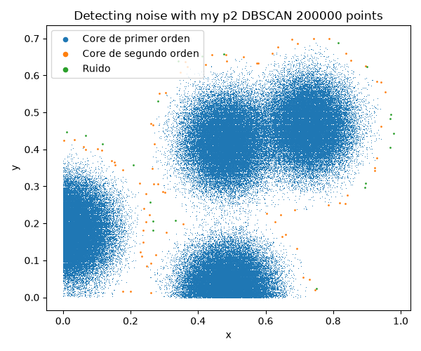
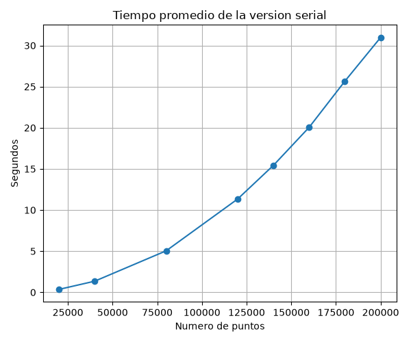
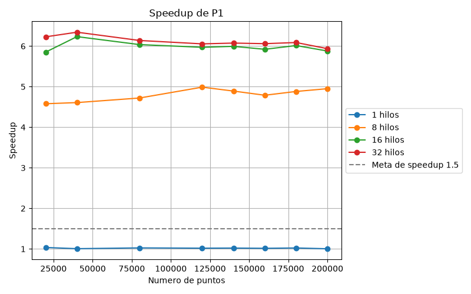
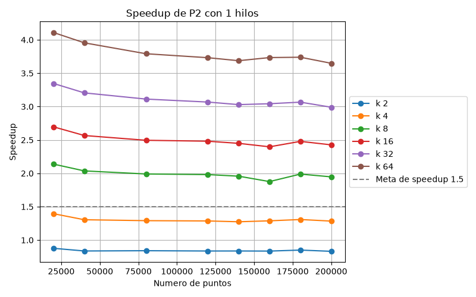
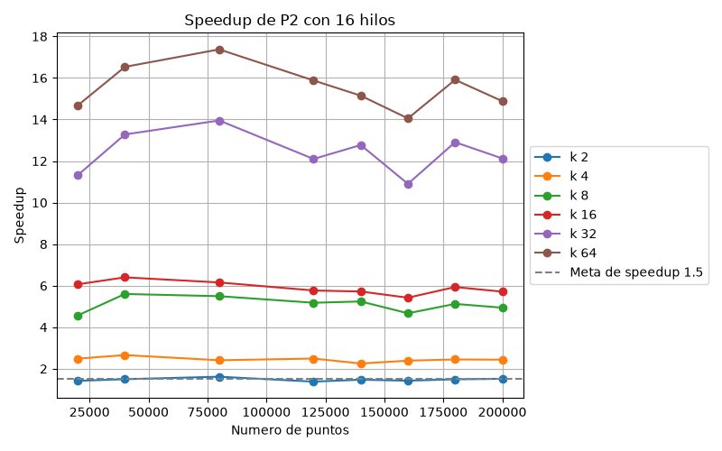
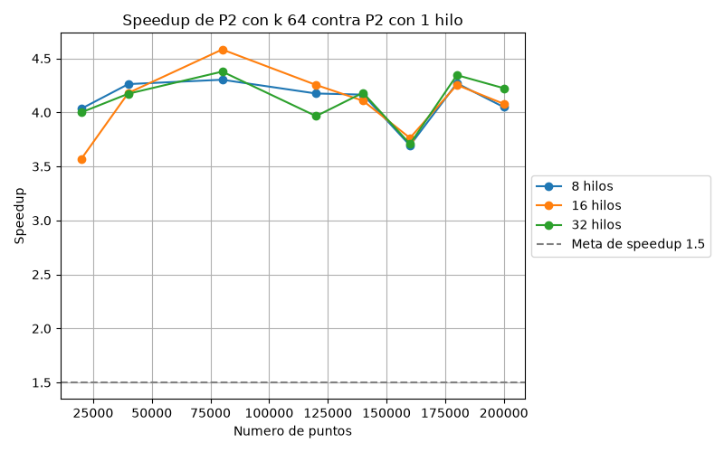
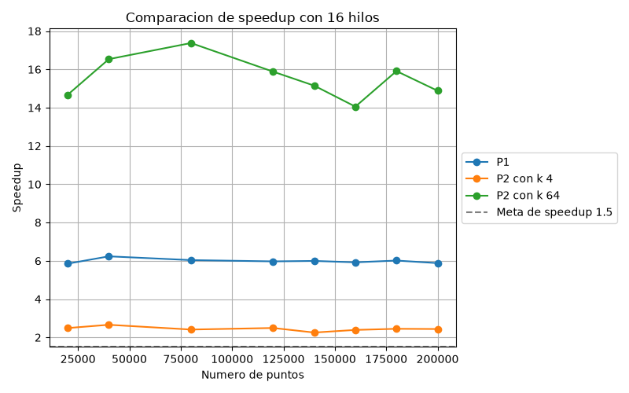

# DBSCAN
## Integrantes
* Jose Luis Santiago Heredia, 208322
* Miguel Ángel Herrera, 206111

## Objetivo
Tenemos puntos en 2D y queremos saber cuáles son ruido, es decir, son aislados, y cuáles están en una zona densa.
Para esto usamos dos cosas: un epsilon, que es la distancia máxima para considerar que dos puntos están cerca (menor o igual a 0.03), y un min_samples, que es el mínimo de puntos cerca para que se considere zona densa (10, contando el propio punto).

## Programa
### Puntos
Cada punto puede terminar con tres etiquetas:
* Core de primer orden: Tiene al menos min_samples puntos, en este caso 10, a distancia menor o igual a epsilon, contándose a sí mismo
* Core de segundo orden: No es core de primer orden, pero está a una distancia menor o igual a epsilon de algún core de primer orden
* Ruido: Ninguna de las dos

### Algoritmo
1. Cada punto cuenta cuántos puntos están a una distancia menor o igual a epsilon (contándose a sí mismo). Si llega a min_samples, se pone como core de primer orden, y si no, es ruido provisional.
2. Para los ruidos provisionales, revisa si hay algún core de primer orden a una distancia menor o igual a epsilon. Si sí hay, pasa a core de segundo orden, y si no, se queda como ruido.

El paso 2 necesita que el paso 1 ya haya terminado para todos los puntos, porque tiene que saber quiénes son core.

Este algoritmo puede tomar mucho tiempo, porque cada punto se compara contra los n puntos, entonces el costo es O(n^2). Por eso, aquí veremos cómo paralelizarlo.

## Códigos
### Serial
El serial es la base contra la que se comparan las dos versiones paralelas, así que tiene que ser correcto y estar bien medido. Está en `dbscanSerial.cpp` y está dividido en funciones pequeñas:
* `contarPuntos` abre el csv y cuenta cuántos renglones tiene, para saber de qué tamaño pedir los arreglos.
* `leerPuntos` guarda la coordenada x de cada punto en un arreglo y la coordenada y en otro.
* `sonVecinos` calcula la distancia euclidiana, y regresa verdadero si es menor o igual a epsilon. 
* `dbscanSerial` tiene los dos pasos del algoritmo.
* `escribirResultados` escribe un csv con x, y y la etiqueta de cada punto (0 ruido, 1 core de primer orden, 2 core de segundo orden), que es el formato que lee la libreta para dibujar la clasificación.

En el paso 1, cada punto recorre los n puntos y cuenta sus vecinos, y no deja de contar aunque ya haya llegado a min_samples, así que todos los puntos hacen el mismo trabajo. En el paso 2, cada ruido busca un core de primer orden cercano y deja de buscar en cuanto encuentra uno. Solo se compara contra cores de primer orden, nunca contra los de segundo orden. Así el resultado no depende del orden en que se recorren los puntos, y eso es lo que permite después paralelizar sin que cambien las etiquetas.

El main hace el experimento. Recorre los 8 tamaños, y para cada uno lee los puntos, hace una corrida de calentamiento que no se mide, porque la primera corrida siempre tardaba más, y luego corre el algoritmo 10 veces y guarda el promedio en `datos/tiempos_serial.csv`. El tiempo se mide con clock() justo antes y justo después de llamar a `dbscanSerial`, así que la lectura y escritura de archivos no cuentan, porque eso no se paraleliza. Como el serial corre en un solo hilo, clock() equivale al tiempo real.

Para comprobar que el serial es correcto se comparó contra el DBSCAN de sklearn con los mismos parámetros. La comparación está en la tercera celda de `DBSCAN_noise_proyecto.ipynb` y el resultado está en la sección de Resultados.

Para compilar y correr los tres programas, desde la carpeta del proyecto, después de generar los puntos con la primera celda de `DBSCAN_noise_proyecto.ipynb`:
```
g++ -O2 -ffp-contract=off dbscanSerial.cpp -o dbscanSerial
g++ -O2 -ffp-contract=off -fopenmp dbscanP1.cpp -o dbscanP1
g++ -O2 -ffp-contract=off -fopenmp dbscanP2.cpp -o dbscanP2
./dbscanSerial
./dbscanP1
./dbscanP2
```
El serial se corre primero, porque P1 y P2 leen sus resultados para comprobar que dan las mismas etiquetas. A P1 y a P2 también se les puede dar un tamaño y un número de repeticiones, por ejemplo `./dbscanP2 20000 1`, para probar un solo tamaño sin escribir archivos.

### P1: Paralelo sobre toda la matriz
En P1 se le agrega el paralelismo al serial. Usamos OpenMP para repartir el trabajo entre varios hilos. Se pone el #pragma omp parallel for para repartir las vueltas del ciclo entre los hilos, y esto solo funciona si las vueltas son independientes. Al terminar el parallel for, el programa espera a que todos los hilos acaben antes de seguir.

Este programa es muy similar al serial, solo que le añadimos el paralelismo.

En el paso 1, cada hilo toma ciertos puntos y escribe la etiqueta de cada uno. No hay conflicto porque cada posición de la etiqueta la escribe un solo hilo.

Para el paso 2, el resultado del paso 1 se guarda en un arreglo aparte que ya no cambia, y las etiquetas finales se escriben en otro arreglo llamado etiqueta. Esto es para evitar una condición de carrera. Con esto, el paso 2 solo lee de un arreglo que no cambia y escribe en otro, así nadie lee lo que otro escribe.

Finalmente, se hace la prueba con distintas cantidades de hilos, y se comparan las etiquetas con las del serial. 

Los tiempos de P1 y P2 se miden con omp_get_wtime(), que mide tiempo de reloj de pared. No se usa clock() en las versiones paralelas porque suma el tiempo de CPU de todos los hilos, así que el tiempo paralelo saldría inflado y el speedup subestimado. El serial sí usa clock(), pero como ejecuta un solo hilo, su valor equivale al tiempo real y la comparación es válida. Con los tiempos se calcula el speedup (T_serial / T_paralelo).

### P2: Paralelo dividido en particiones
La idea de P2 es que en esta ocasión el plano se divide en k pedazos (particiones), y cada punto se compara contra los puntos de su propia partición y contra los de las particiones vecinas que estén cerca, en lugar de compararse contra todos. Sigue siendo el mismo algoritmo, solo cambia dónde busca y cómo se reparte el trabajo, y las etiquetas tienen que salir igual que en el serial.

Para hacer esto, primero se calcula la cuadrícula: se convierte k en columnas x filas (2 es 2x1, 4 es 2x2, 8 es 4x2 y así hasta 64, que es 8x8), y se buscan los valores mínimos y máximos de x y de y para calcular qué tan ancha y qué tan alta es cada celda. Después a cada punto se le calcula su partición, y las particiones quedan numeradas de 0 a k - 1. Con eso, cada partición arma su propia lista de puntos: los que son suyos y también los de las particiones vecinas que caen a una distancia menor o igual a epsilon de su rectángulo, a los que llamamos el borde. De cada lista solo se guardan los índices originales de los puntos, y las coordenadas se leen de los arreglos x y y con esos índices.

El borde es necesario porque un punto cerca de la frontera puede tener vecinos en la partición de al lado, y si no los contamos se clasificaría mal. Cualquier vecino de un punto está a distancia epsilon o menos, así que siempre cae dentro del rectángulo de su partición agrandado por epsilon. Por eso la lista de cada partición contiene todos los vecinos posibles de sus puntos, no se pierde ninguno y las etiquetas coinciden con las del serial.

Después P2 tiene tres partes, cada una con un parallel for sobre las particiones: armar las listas, el paso 1 y el paso 2. Antes de armar las listas se pide, fuera de la región paralela, memoria para n índices en cada partición, que es lo máximo que puede tener. Luego cada hilo llena la lista de una partición. En el paso 1, cada hilo toma una partición, y para cada uno de sus puntos cuenta cuántos vecinos hay en la lista de la partición a una distancia menor o igual a epsilon, contra todos los puntos de la lista y sin dejar de contar al llegar a min_samples, igual que el serial. Si llega a min_samples es core de primer orden, y si no, es ruido provisional. Cada punto pertenece a una sola partición, y su etiqueta se escribe por su índice original, entonces cada hilo solo escribe los puntos de sus propias particiones y no hay conflicto. Al terminar el parallel for se espera a que todos los hilos acaben el paso 1, porque el paso 2 necesita saber quiénes son core, incluso los que son de otra partición. En el paso 2, para los ruidos provisionales se revisa si en la lista hay algún core de primer orden a una distancia menor o igual a epsilon, y si sí hay, pasa a core de segundo orden. Igual que en P1, se lee de un arreglo que ya no cambia (el resultado del paso 1) y se escribe en otro (las etiquetas finales), para que nadie lea lo que otro escribe.

Es importante mencionar que usamos schedule(dynamic, 1), que es cuando un hilo termina su partición y pide otra, en lugar de tener un reparto fijo. Esto es porque las particiones no tienen la misma cantidad de puntos, entonces con un reparto fijo unos hilos acabarían antes y se quedarían esperando. Con dynamic se reduce esa espera.

Otra cosa importante es que k limita el paralelismo: con k = 2 solo hay dos particiones, entonces aunque haya más hilos no tienen trabajo que tomar.

Por último, P2 puede ser más rápida incluso con un solo hilo. Probablemente porque cada punto se compara contra menos puntos (los de su lista, y no los n). Este efecto no se debe al paralelismo, por eso hay que separar el efecto de k del efecto de los hilos.

## Resultados
### Equipos
El experimento se corrió completo en una computadora, la de Miguel: AMD Ryzen AI 7 350, con 8 núcleos físicos y 16 cores virtuales (2 hilos por núcleo), 8 MB de caché L2 y 16 MB de L3, y 15 GB de RAM, de los cuales WSL2 tiene unos 7 GB. Corre en Ubuntu 26.04 dentro de WSL2 sobre Windows 11, con g++ 15.2.0. Los hilos probados fueron 1, 8, 16 y 32.

Los programas se compilaron con `g++ -O2`, y P1 y P2 además con `-fopenmp`. También se usó `-ffp-contract=off`, y los programas se corrieron como `./dbscanSerial`, `./dbscanP1` y `./dbscanP2`. Los hilos no están fijos en el código: cada programa mide los cores virtuales con `omp_get_num_threads()` y de ahí saca 1, la mitad, todos y el doble.

### Verificación
Cada configuración compara sus etiquetas contra las del serial y avisa con un mismatch si hay diferencias. Ninguna configuración avisó mismatch en los 8 tamaños, con todos los valores de k y de hilos. Además, los archivos de resultados son idénticos entre los tres programas.




### Serial
El tiempo crece con el cuadrado del número de puntos: al duplicar los puntos, el tiempo se multiplica por casi 4 (de 20000 a 40000 puntos pasa de 0.358 s a 1.355 s). Esto es lo esperado, porque en el paso 1 cada punto se compara contra los n puntos.

| Puntos | Tiempo (s) |
|---|---|
| 20000 | 0.358 |
| 80000 | 5.048 |
| 120000 | 11.343 |
| 200000 | 30.977 |



Para comprobar que el serial da el resultado correcto, se comparó contra el DBSCAN de sklearn con los mismos parámetros, eps = 0.03 y min_samples = 10, usando los mismos archivos de puntos. sklearn marca el ruido con la etiqueta -1 y nuestro programa con 0, así que se comparó punto por punto si cada uno es ruido o no. Los cores de primer y de segundo orden de nuestro programa corresponden a los puntos que sklearn mete en algún cluster.

| Puntos | Ruido sklearn | Ruido serial | Diferencias |
|---|---|---|---|
| 20000 | 45 | 45 | 0 |
| 40000 | 33 | 33 | 0 |
| 80000 | 34 | 34 | 0 |

No hubo ninguna diferencia. Solo se usaron estos tres tamaños porque sklearn guarda en memoria todos los vecinos de cada punto, y con más puntos eso ocuparía varios GB, más de los que tiene la computadora. Como P1 y P2 dan exactamente las mismas etiquetas que el serial, también coinciden con sklearn.

### P1
Speedup de P1 contra el serial con 200000 puntos:

| | 1 hilo | 8 hilos | 16 hilos | 32 hilos |
|---|---|---|---|---|
| Speedup | 1.00 | 4.95 | 5.88 | 5.94 |

Con 1 hilo P1 tarda prácticamente lo mismo que el serial, lo cual tiene sentido porque es el mismo algoritmo. Con más hilos mejora hasta que se acaban los núcleos reales. El speedup llega a 4.95 con 8 hilos (un hilo por núcleo físico), a 5.88 con 16 y a 5.94 con 32. De 8 a 16 hilos se gana poco, porque los hilos extra comparten el núcleo con otro hilo, y con 32 ya no se gana nada. El speedup es parecido en todos los tamaños: con 16 hilos va de 5.85 a 6.23 entre 20000 y 200000 puntos.



### P2
En P2 hay que separar dos efectos, el de k y el de los hilos.

El efecto de k se ve con 1 hilo, donde no hay paralelismo. Speedup de P2 con 1 hilo contra el serial con 200000 puntos:

| | k = 2 | k = 4 | k = 8 | k = 16 | k = 32 | k = 64 |
|---|---|---|---|---|---|---|
| Speedup | 0.83 | 1.28 | 1.95 | 2.43 | 2.99 | 3.65 |

Con k = 4 o más P2 ya es más rápido que el serial aun con un solo hilo, y más entre más grande es k. La mejora se debe a que cada punto se compara contra los puntos de la lista de su partición y no contra los n puntos. Con k = 2 pasa lo contrario, P2 es un poco más lento que el serial (0.83). Probablemente porque cada lista tiene todavía como la mitad de los puntos, entonces casi no se ahorran comparaciones, y P2 además lee las coordenadas por índice, saltando por la memoria, y arma las listas recorriendo los n puntos dentro del tiempo medido.

El efecto de los hilos se ve comparando P2 contra P2 con 1 hilo y el mismo k. Con 200000 puntos y k = 64, los hilos dan 4.05 con 8 hilos, 4.08 con 16 y 4.22 con 32. Con k = 4 solo dan 1.93 con 8 hilos. Es menos que en P1 por dos razones:
* Con k particiones solo puede haber k hilos trabajando, así que con k = 2 el máximo es 2 y con k = 4 el máximo es 4.
* Las particiones tienen cantidades de puntos muy distintas, porque los puntos vienen de 4 nubes. Con k = 4 la partición más grande tiene el 39% de los puntos, y con k = 64 tiene el 11% y hay 9 particiones vacías. Los hilos que terminan antes tienen que esperar a la partición más grande.

Speedup de P2 contra el serial con 200000 puntos, con 8, 16 y 32 hilos:

| | k = 2 | k = 4 | k = 8 | k = 16 | k = 32 | k = 64 |
|---|---|---|---|---|---|---|
| 8 hilos | 1.48 | 2.48 | 4.96 | 5.89 | 12.77 | 14.77 |
| 16 hilos | 1.52 | 2.44 | 4.94 | 5.71 | 12.13 | 14.88 |
| 32 hilos | 1.48 | 2.41 | 4.96 | 5.84 | 12.23 | 15.41 |

El mejor speedup de P2 contra el serial fue de 17.37, con 80000 puntos, k = 64 y 16 hilos. Con 200000 puntos y k = 64, el mejor fue de 15.41 con 32 hilos.

En P2 pasar de 8 a 16 hilos no mejora, ni de 16 a 32. Probablemente porque con 8 hilos ya se usan los 8 núcleos físicos, los hilos extra solo comparten núcleo, y la partición más grande sigue marcando el tiempo total.





### Comparación entre P1 y P2
Con 8 hilos o más, P1 y P2 con k = 4 o más pasan la meta de speedup de 1.5. P2 con k = 2 queda alrededor de 1.5, a veces un poco abajo. P2 con k = 64 fue mucho más rápida en tiempo total que P1: con 16 hilos y 200000 puntos, 14.88 contra 5.88. Pero sobre todo porque al dividir el plano en particiones cada punto se compara contra menos puntos, no por los hilos. Con k = 4, en cambio, P2 es más lenta que P1 (2.44 contra 5.88). P1 fue la que mejor aprovechó los hilos, porque reparte puntos y no zonas, entonces a cada hilo le toca un trabajo parecido. En P2 el reparto depende de cuántos puntos caen en cada partición, y con estos datos queda muy disparejo.



## Conclusión
Hicimos tres versiones del algoritmo ingenuo de DBSCAN para detectar ruido: una serial, P1, que reparte los puntos entre los hilos sin dividir la matriz, y P2, que divide el plano en k particiones y reparte particiones. Las tres dan exactamente las mismas etiquetas en todos los tamaños y configuraciones. Ninguna versión paralela tiene condiciones de carrera, porque cada hilo solo escribe la etiqueta de sus propios puntos y el paso 2 lee el resultado del paso 1 de un arreglo que ya no cambia. Para mantener la consistencia en P2, la lista de cada partición incluye también los puntos vecinos a distancia epsilon o menos de su rectángulo, así que no se pierde ningún vecino del otro lado de una frontera.

Con 200000 puntos, P1 llegó a un speedup de 5.94 y P2 llegó a 15.41, y el mejor de P2 en todo el experimento fue de 17.37. Con 8 hilos o más, las dos versiones superan la meta de speedup de 1.5, salvo P2 con k = 2, que queda justo alrededor de 1.5.

P2 fue la más rápida, pero hay que leer bien por qué. La mayor parte de su ventaja viene de dividir el plano: aun con 1 hilo, con k = 64 es 3.65 veces más rápida que el serial, porque cada punto se compara contra los puntos de su lista y no contra todos. Los hilos le aportan entre 4 y 4.2 veces más con k = 64, porque las particiones quedan con cantidades de puntos muy distintas y k limita cuántos hilos pueden trabajar a la vez. Con k pequeño P2 puede ser peor que P1, y con k = 2 y 1 hilo incluso peor que el serial. P1, en cambio, fue la que mejor aprovechó los hilos, porque a cada hilo le toca un trabajo parecido.

También vimos que el hardware pone el límite. La computadora tiene 8 núcleos físicos, y en las dos versiones el speedup casi no mejora al pasar de 8 hilos a 16 o a 32, porque los hilos extra comparten núcleo. Usar más hilos que núcleos físicos no ayudó.

Por último, para que los resultados fueran confiables promediamos 10 repeticiones, hicimos una corrida de calentamiento antes de medir y corrimos los programas sin otros programas abiertos.

## Uso responsable y ético de IA Generativa
Siguiendo los lineamientos de IEEE y de Elsevier que vienen en las instrucciones, declaramos que en este proyecto usamos IA generativa, en particular Claude de Anthropic.

La usamos como apoyo para:
* Proponer la estructura de los programas y revisar errores en el código.
* Mejorar la redacción y ordenar partes de este documento.

Para usarla de forma responsable:
* Revisamos y entendimos todo el código entregado, y somos responsables de él y de lo que dice este documento. 
* La IA no es autora del trabajo, es una herramienta. Las decisiones sobre cómo paralelizar, qué experimentos correr y cómo interpretar los resultados fueron nuestras.
